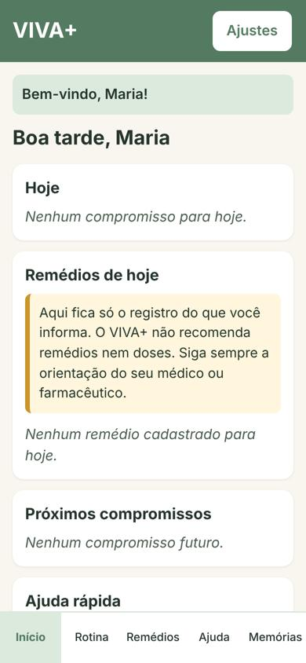

# VIVA+

> **Tecnologia para viver melhor.**

Plataforma de autonomia, organização cotidiana e conexão familiar para pessoas idosas, familiares e cuidadores autorizados.



## Estado atual

| Fase | Descrição | Status |
|---|---|---|
| 1 | App de celular com `localStorage` | Funcional, não testado em navegadores reais |
| 2 | Integração com Supabase (Auth, banco, RLS) | Planejada; esquema pronto em `database/` |
| 3 | Família, mensagens, permissões reais | Planejada |
| 4 | Testes automatizados e validação com usuários | Planejada |
| 5 | Publicação | Não publicado |

## Estrutura do repositório

```
viva-plus/
├── app/                  App de celular (fase 1), arquivo único HTML
├── docs/                 Documentação de engenharia (22 documentos + ADRs)
│   ├── adr/              Registros de decisão arquitetural
│   └── diagrams/         Espaço para diagramas versionáveis
├── database/
│   ├── migrations/       Esquema PostgreSQL / Supabase com RLS
│   └── seeds/            Dados fictícios de demonstração
├── tests/                Plano e futuros testes
├── .env.example          Variáveis para a fase 2 (sem segredos)
├── CHANGELOG.md
├── CONTRIBUTING.md
├── SECURITY.md
└── README.md
```

## Como usar o app

Abra `app/viva-plus.html` no navegador do celular. Detalhes em [app/README.md](app/README.md).

## Documentação

Comece por [docs/01-VISAO-GERAL.md](docs/01-VISAO-GERAL.md). O índice completo está na pasta [docs/](docs/).

Destaques:
- Requisitos: [05-ESPECIFICACAO-DE-REQUISITOS.md](docs/05-ESPECIFICACAO-DE-REQUISITOS.md)
- Arquitetura: [09-ARQUITETURA-ARC42.md](docs/09-ARQUITETURA-ARC42.md) e [10-ARQUITETURA-C4.md](docs/10-ARQUITETURA-C4.md)
- Banco de dados: [12-MODELO-DE-DADOS.md](docs/12-MODELO-DE-DADOS.md)
- Segurança e LGPD: [14-SEGURANCA-E-LGPD.md](docs/14-SEGURANCA-E-LGPD.md)

## Princípios

- A pessoa idosa é protagonista da própria rotina.
- O VIVA+ não recomenda nem prescreve medicamentos, não define doses e não simula atendimento de emergência.
- Dados pessoais são mínimos e pertencem a quem os informa.

## Testes

Nenhum teste automatizado foi executado até o momento. Ver [docs/16-PLANO-DE-TESTES.md](docs/16-PLANO-DE-TESTES.md).

## Contribuição e segurança

- [CONTRIBUTING.md](CONTRIBUTING.md)
- [SECURITY.md](SECURITY.md)

## Licença

A definir pelo titular do projeto.

## Autora

Desenvolvido por **Lívia Vittoria** · [GitHub](https://github.com/liviavittoria28-create)
