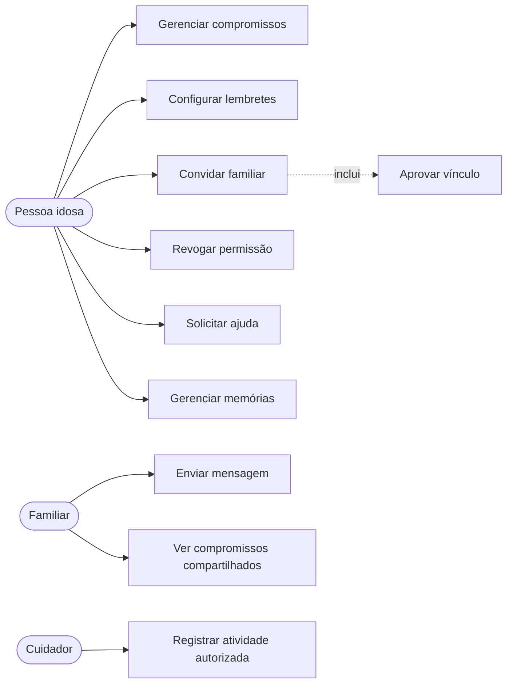

# 08 — Casos de uso

## Atores

- **Pessoa idosa** (principal)
- **Familiar** (mediante autorização)
- **Cuidador autorizado** (mediante autorização)
- **Sistema de notificações** (secundário)

## Diagrama

## UC01 — Gerenciar compromissos

- **Pré-condição:** usuário autenticado.
- **Fluxo principal:** 1) usuário abre a agenda; 2) escolhe "novo compromisso"; 3) informa título, data e hora; 4) confirma; 5) sistema salva e exibe na agenda.
- **Fluxos alternativos:** editar ou excluir (exclusão lógica).
- **Exceções:** data inválida → mensagem clara e foco no campo; falha de conexão → dados não são exibidos como salvos.
- **Pós-condição:** compromisso registrado e visível conforme permissões.

## UC02 — Convidar familiar

- **Pré-condição:** pessoa idosa autenticada.
- **Fluxo principal:** 1) informa e-mail do familiar; 2) escolhe tipos de permissão; 3) sistema cria convite; 4) familiar aceita; 5) pessoa idosa aprova o vínculo.
- **Exceções:** convite expirado ou já usado → mensagem e opção de novo convite.
- **Pós-condição:** vínculo ativo com permissões concedidas.

## UC03 — Revogar permissão

- **Pré-condição:** vínculo ativo.
- **Fluxo principal:** 1) pessoa idosa acessa permissões; 2) escolhe revogar; 3) confirma; 4) sistema revoga e registra auditoria.
- **Pós-condição:** acesso removido imediatamente.

## UC04 — Solicitar ajuda

- **Pré-condição:** pelo menos um contato de confiança cadastrado.
- **Fluxo principal:** 1) usuário toca em "Preciso de ajuda"; 2) sistema mostra contatos; 3) usuário confirma o envio; 4) sistema registra e notifica.
- **Exceções:** sem contatos → orientação para cadastrar; o sistema não simula atendimento de emergência.
- **Pós-condição:** solicitação registrada no histórico.

## UC05 — Registrar atividade (cuidador)

- **Pré-condição:** permissão de registro de atividades concedida.
- **Fluxo principal:** 1) cuidador escolhe a atividade; 2) registra observação; 3) salva.
- **Pós-condição:** registro visível à pessoa idosa e a quem tiver permissão.
