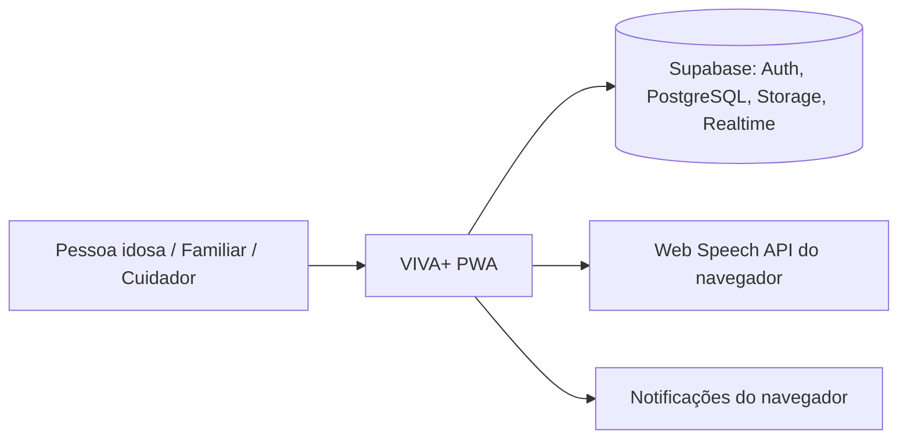

# 09 — Arquitetura (arc42)

## 1. Introdução e objetivos
Ver [02-TERMO-DE-ABERTURA.md](02-TERMO-DE-ABERTURA.md). Objetivos de qualidade principais: segurança e privacidade, acessibilidade, simplicidade de uso.

## 2. Restrições arquiteturais
- Front-end em React + TypeScript + Vite.
- Back-end gerenciado pelo Supabase (PostgreSQL, Auth, Storage, Realtime).
- Autorização aplicada no banco por RLS, não apenas na interface.
- Chave `service_role` nunca no cliente.

## 3. Contexto e escopo

## 4. Estratégia de solução
SPA com PWA. Dados e autorização no Supabase. Regras de permissão expressas em políticas RLS e funções SQL. Realtime para mensagens e avisos.

## 5. Visão de blocos de construção
Camadas: `components/` (interface), `pages/` (rotas), `hooks/` (estado e interação), `services/` (acesso ao Supabase), `contexts/` (sessão e preferências), `utils/` (funções puras), `types/` (tipos compartilhados).

## 6. Visão de execução
Fluxo típico: usuário autentica → front-end consulta tabelas via Supabase client → RLS filtra linhas → resposta exibida.

## 7. Visão de implantação
Front-end estático em serviço como Render (static site) ou equivalente. Banco e autenticação no Supabase. Detalhes em [18-IMPLANTACAO-E-OPERACAO.md](18-IMPLANTACAO-E-OPERACAO.md).

## 8. Conceitos transversais
Autorização por RLS, auditoria, validação de entradas (Zod ou equivalente, a definir), acessibilidade, LGPD.

## 9. Decisões arquiteturais
Ver [docs/adr/](adr/).

## 10. Requisitos de qualidade
Ver RNF001 a RNF010 em [05-ESPECIFICACAO-DE-REQUISITOS.md](05-ESPECIFICACAO-DE-REQUISITOS.md).

## 11. Riscos e dívida técnica
Ver [20-RISCOS-E-LIMITACOES.md](20-RISCOS-E-LIMITACOES.md).

## 12. Glossário
Ver [21-GLOSSARIO.md](21-GLOSSARIO.md).
