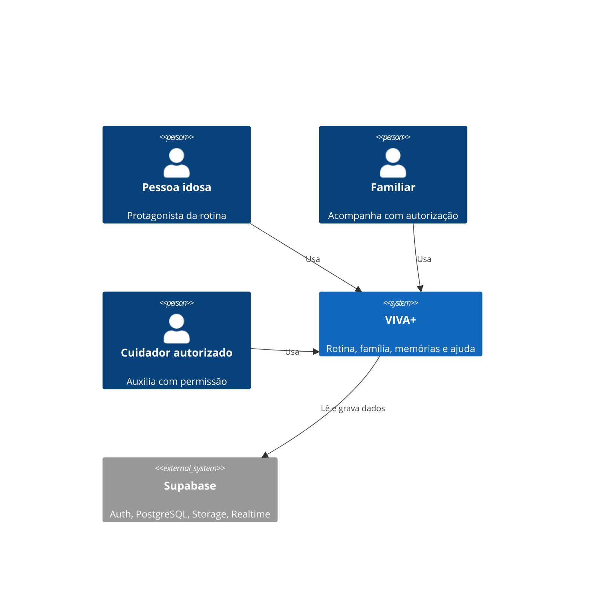
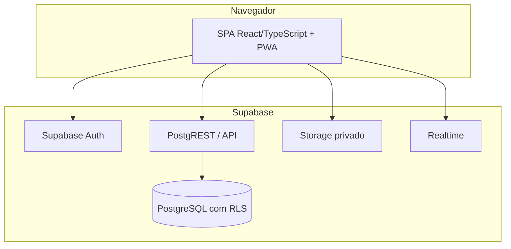

# 10 — Modelo C4

## Nível 1 — Contexto do sistema

## Nível 2 — Containers

## Nível 3 — Componentes (front-end)

Componentes previstos: `AgendaPage`, `LembretesPage`, `FamiliaPage`, `AjudaPage`, `MemoriasPage`, `AssistentePorVoz`, `AuthProvider`, `PreferenciasAcessibilidadeProvider`, serviços por domínio (`appointmentsService`, `familyService`, etc.).

## Nível 4 — Implantação

Ver [18-IMPLANTACAO-E-OPERACAO.md](18-IMPLANTACAO-E-OPERACAO.md).
