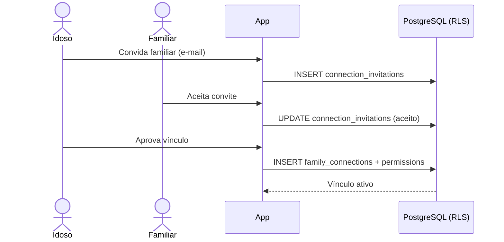
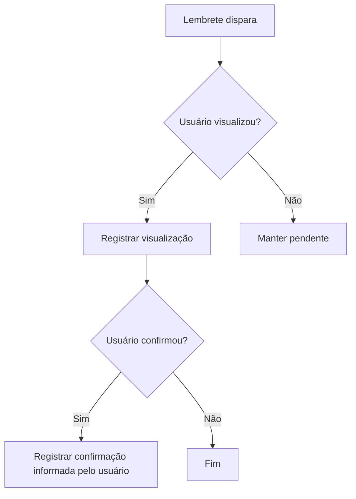
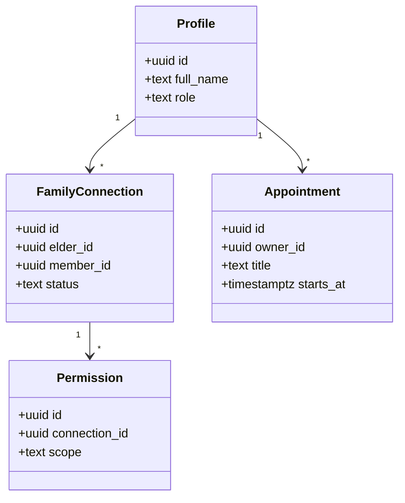

# 11 — Diagramas UML

## Sequência — Convite e aprovação de vínculo

## Atividades — Confirmação de lembrete

## Classes — Núcleo de dados

## Componentes e implantação

Ver [10-ARQUITETURA-C4.md](10-ARQUITETURA-C4.md).
