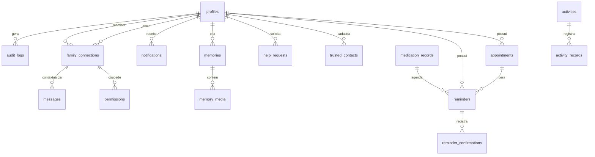

# 12 — Modelo de dados

Banco: PostgreSQL (Supabase). Chaves primárias UUID. Timestamps em `timestamptz`. Exclusão lógica onde há valor de histórico. Implementação em `database/migrations/`.

## Entidades (18)

profiles, family_connections, connection_invitations, permissions, appointments, reminders, medication_records, reminder_confirmations, messages, trusted_contacts, help_requests, memories, memory_media, activities, activity_records, notification_preferences, notifications, audit_logs.

## Diagrama ER (resumo)

## Cardinalidades e chaves

Detalhes por tabela no [13-DICIONARIO-DE-DADOS.md](13-DICIONARIO-DE-DADOS.md). Migrations SQL em `database/migrations/0001_init.sql`.

## Índices

Índices em chaves estrangeiras e em colunas de consulta frequente (`owner_id`, `starts_at`, `member_id`).

## Estratégia de migrations

Arquivos numerados e imutáveis após aplicados. Novas mudanças criam novo arquivo. Seeds apenas com dados fictícios.

## Políticas RLS

Toda tabela com dados pessoais tem RLS habilitado. Acesso por padrão negado. Acesso a dados de outra pessoa exige vínculo ativo e permissão específica, verificados por função SQL `has_permission`.
